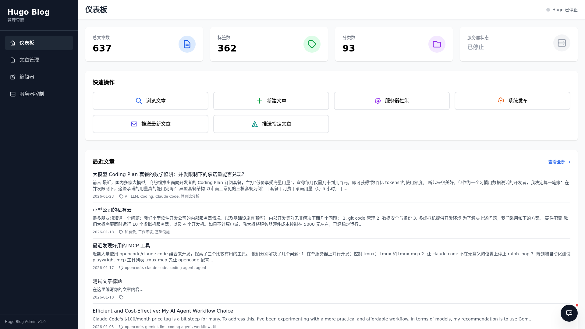

# Hugo Admin

[](LICENSE)
[](https://go.dev/)
[](https://codecov.io/gh/sun-praise/hugo-admin)
[](https://gohugo.io/)
[](https://sun-praise.github.io/hugo-admin/)

[中文](README.zh-CN.md) | [English](README.md)

> **版本说明**
>
> - **`main`（v3）**——活跃开发分支。后端已完全用 **Go** 重写
>   （单二进制、gRPC 插件、SSE 实时推送）。日常开发请用本分支。
> - **`v2`**——此前的 Python/Flask 实现，**维护模式**保留
>   （仅安全修复，不再新增功能）。完整 Python 历史在该分支；
>   迁移要点见[「v2 → v3 迁移」](#v2--v3-迁移)。

## 截图



## 功能特性

- **📊 仪表板**：博客统计信息与常用操作概览
- **📝 文章管理**：按分类和标签浏览、搜索、筛选文章
- **✏️ Markdown 编辑器**：在线编辑，支持乐观锁、剪贴板粘贴图片、AI frontmatter 建议、TTS 生成
- **🚀 Hugo 服务器控制**：启动/停止 Hugo 开发服务器，SSE 实时日志
- **🔍 高级搜索**：全文搜索，支持分类与标签过滤
- **⚡ 实时更新**：基于 SSE 的实时事件推送
- **🔐 密码登录**：单管理员认证，保护所有 API 与实时通道
- **🔌 插件系统**：基于 gRPC 的插件扩展——详见 [`proto/plugin.proto`](proto/plugin.proto)
- **🤖 AI 助手**：博客感知的对话、内联改写、文章导入（AI 补全 frontmatter 与封面生成）
- **📧 邮件推送**：通过 listmonk 将最新文章推送给订阅者
- **🎨 主题管理**：Hugo 主题的发现、安装、预览与启用

## 技术栈（v3）

- **后端**：Go 1.24+ —— 标准库 `net/http`、`modernc.org/sqlite`（免 CGO）、`grpc-go`、`trpc-agent-go`
- **前端**：React + TypeScript + Vite + Tailwind CSS
- **实时通信**：Server-Sent Events（`/api/events`），连接 v2 后端时自动回退 Socket.IO
- **存储**：SQLite（与 v2 共享表结构）+ YAML frontmatter 文件
- **插件**：gRPC 子进程，配置用 Fernet 加密（密钥与 v2 共享）

## 快速开始

```bash
# 构建前端
cd frontend && pnpm install && pnpm build && cd ..

# 编译并运行（默认：端口 5050，凭据文件 data/auth.json）
go build -o hugo-admin ./cmd/hugo-admin
./hugo-admin

# 也可通过环境变量指定：
AUTH_STORE=/path/to/auth.json \
HUGO_ROOT=/path/to/blog \
CONTENT_DIR=/path/to/blog/content \
PORT=8961 ./hugo-admin
```

本地开发推荐用根目录的 `./run.sh`：自动构建前端（产物缺失时）、编译后端并启动，详见 [docs/QUICKSTART.md](docs/QUICKSTART.md)。

### Docker

```bash
docker build -f Dockerfile-go -t hugo-admin-go .
docker run -p 5050:5050 -v ~/.hugo-admin:/root/.hugo-admin -v /path/to/blog:/blog \
  -e HUGO_ROOT=/blog hugo-admin-go
```

### 配置

| 环境变量 | 默认值 | 说明 |
|---|---|---|
| `PORT` | `5050` | HTTP 监听端口 |
| `SECRET_KEY` | 开发默认值 | 会话签名密钥（语义同 v2） |
| `AUTH_STORE` | `data/auth.json` | 凭据文件（兼容 werkzeug 哈希） |
| `HUGO_ROOT` | 当前目录 | Hugo 站点根目录 |
| `CONTENT_DIR` | `<HUGO_ROOT>/content` | 内容目录 |
| `AI_API_KEY` / `AI_BASE_URL` / `AI_MODEL` | — | AI 服务配置 |
| `OPENROUTER_API_KEY` | — | 封面图生成 |

环境变量也可写入仓库根 `.env`（`.env.example` 为模板，已 gitignore，不会误提交）。

## v2 → v3 迁移

v3 后端是对 v2 的逐行为移植，由 **105 条 API 契约样本**
（`contracts/api_samples.jsonl`）在 CI 中对 Go 实现回放验证。关键兼容性保证：

- **会话 Cookie 互通**——浏览器登录 v2 后即登录 v3，反之亦然
  （同一 itsdangerous HMAC 方案）。
- **`auth.json` 凭据共享**——werkzeug scrypt/pbkdf2 哈希两套实现互认。
- **SQLite 共享**——一侧写入的推送历史与聊天会话另一侧可读
  （插件配置的 `~/.hugo-admin/` Fernet 密钥同样共享）。
- **前端同时兼容两套后端**——实时层优先 SSE（v3），连 v2 时自动回退 Socket.IO。

已知行为差异（详见提交记录）：

- v3 中在设置里修改 Hugo 根目录需要重启服务（v2 会热替换服务实例）。
- `save_file` 的 YAML 输出使用 yaml.v3（字符串双引号、块列表缩进），
  与 PyYAML 不完全一致——语义等价，Hugo 均可解析。
- 文章缓存改为直接文件系统扫描（无 SQLite 缓存层）；
  `/api/cache/stats` 报告实时计数。

## 开发

```bash
go build ./... && go vet ./...
go test ./... -count=1              # 10 个包，含契约回放

# 重新录制 API 契约样本（需要 v2 检出跑 pytest 录制器）：
# RECORD_CONTRACT=1 CONTRACT_OUT=contracts/api_samples.jsonl pytest tests/

cd frontend && pnpm build           # 重建 admin-ui
```

## 许可证

Apache-2.0 —— 详见 [LICENSE](LICENSE)
